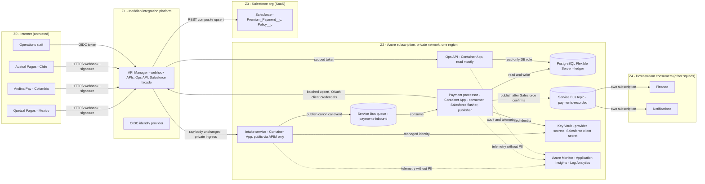
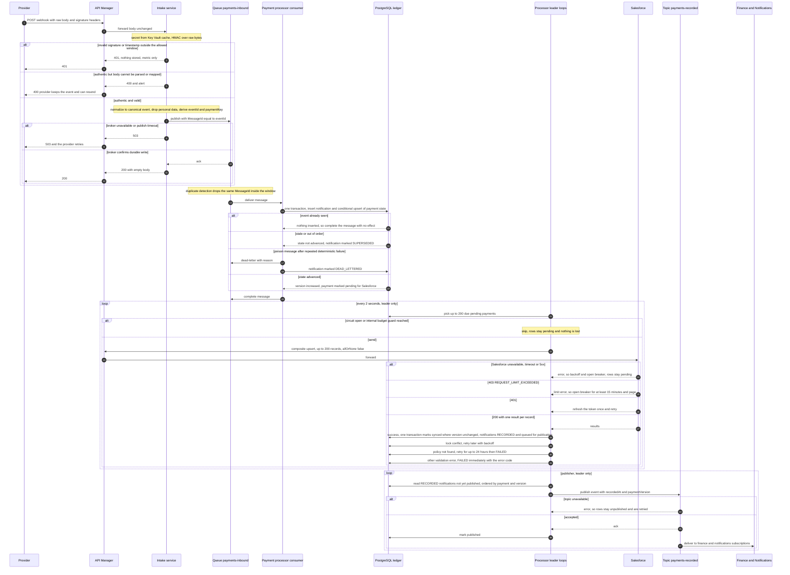

# Solution Design — Premium Payment Notifications (Part A)

Meridian Mutual · Payments Integration squad · Scope: Mexico (Quetzal Pagos), Colombia (Andina Pay), Chile (Austral Pagos)

## 1. Summary of the design
Payment providers (Quetzal, Andina and Austral) notify us of payment events through webhooks. Each webhook is published through the API Manager, which forwards the request unchanged to our **intake service**. The intake service first verifies the provider's signature against the raw request bytes, exactly as received, which guarantees the notification is authentic. Only then does it parse the notification and translate it into a **canonical event**, discarding all payer personal data so that only the information the business needs travels through the rest of the system.

The canonical event is published to an **Azure Service Bus queue**. Once the broker confirms the message is durably stored, we guarantee it will be processed, and the intake answers `2xx` to the provider through the API Manager. A successful response is all the provider needs to stop retrying. If anything fails before the message reaches the broker (invalid signature, unreadable body, broker unavailable), the intake answers with the appropriate error code and the provider is responsible for retrying according to its own policy.

Everything after the `2xx` is asynchronous. We cannot call Salesforce inside the webhook request: the providers' timeouts are short (5 to 10 seconds) and Salesforce is only about 97% available. A **payment processor** service consumes the events from the queue and records each notification and the current state of each payment in a relational database (**PostgreSQL**). This gives traceability, discards duplicates and resolves out-of-order notifications. The processor then sends the pending payments to Salesforce, also through the API Manager, in bulk batches of up to 200 records per API call instead of one message at a time, which protects the shared API budget. If Salesforce is unavailable, the pending payments wait in the database until it recovers.

**Once Salesforce confirms that a payment was recorded, the processor publishes a payment-recorded event to a Service Bus topic**, so Finance and Notifications only receive events that are already in Salesforce. They subscribe on their own; we do not build them.

## 2. Context diagram and trust boundaries

## 3. Sequence diagram — one notification

## 4. Canonical payment event

The event has **no payer personal data** (no name, national ID, email) and no card data. Contract: `docs/api/events/premium-payment.schema.json

The same schema is used twice: the intake publishes it to the queue **without** `recordedAt` and `paymentVersion`; the processor publishes it to the topic **with** them, once Salesforce has confirmed the record.

| Field | Type | Required | Notes |
|---|---|---|---|
| `schemaVersion` | string | yes | `"1.0"`. Also sent as Service Bus application property `schema-version`. |
| `eventId` | string | yes | Idempotency key of the business event, derived by the adapter (see §5). Stable across provider retries. |
| `paymentKey` | string | yes | Identity of the payment: `<Provider>:<providerPaymentId>`, e.g. `Andina:TRX-CO-5521907`. Becomes `Payment_Key__c`. Max 80 characters. |
| `correlationId` | string (UUID) | yes | Created at intake (or taken from a valid W3C `traceparent`). Travels end to end. |
| `country` | enum `MX`/`CO`/`CL` | yes | Fixed by the endpoint, not by payload content. |
| `provider` | enum `QUETZAL`/`ANDINA`/`AUSTRAL` | yes | |
| `providerEventId` | string or null | no | Provider event id where one is stable (Quetzal `id`, Austral `eventId`). Null for Andina. |
| `providerNotificationId` | string or null | no | Andina `notificacion_id`. Informational only: it changes on every retry. |
| `providerPaymentId` | string | yes | Charge / transaction / payment id. |
| `policyNumber` | string or null | yes | Normalized upper case, must match `^POL-(MX\|CO\|CL)-\d{9}$` and the endpoint's country. **Null** if the provider reference does not match; the raw reference is not kept. |
| `status` | enum `PENDING`/`CAPTURED`/`FAILED`/`REFUNDED` | yes | Canonical state. `REFUNDED` only for full refunds and reversals. |
| `providerStatus` | string | yes | Original provider type or state, for audit and re-mapping. |
| `amount` | object `{value, currency}` | yes | `value` is an exact decimal **string** in the currency's scale (`"1250.00"`, `"45990"`). Never a float. |
| `refundedAmount` | object or null | no | Present when money was returned. |
| `refundScope` | enum `NONE`/`PARTIAL`/`FULL` | yes | |
| `occurredAt` | string (UTC, RFC 3339) | yes | Time of the state change at the provider. |
| `receivedAt` | string (UTC) | yes | Time the intake received it. Start of the freshness measure. |
| `reasonCode` | string or null | no | Failure or reversal reason, only from a closed list; anything else becomes `OTHER`. |
| `paymentMethod` | string or null | no | e.g. `PSE`, `TARJETA`. Type only. |
| `recordedAt` | string (UTC) | only on the topic | Time Salesforce confirmed the record. |
| `paymentVersion` | integer | only on the topic | Ledger version of the payment this event produced. Lets consumers order events of the same payment. |

### Mapping: provider → canonical

| Canonical | Quetzal (MX) | Andina (CO) | Austral (CL) |
|---|---|---|---|
| `eventId` | `QUETZAL:` + `id` | `ANDINA:` + `transaccion.id` + `:` + `transaccion.estado` | `AUSTRAL:` + `eventId` |
| `paymentKey` | `Quetzal:` + `data.charge.id` | `Andina:` + `transaccion.id` | `Austral:` + `payment.paymentId` |
| `providerEventId` | `id` | null | `eventId` |
| `providerNotificationId` | null | `notificacion_id` | null |
| `providerPaymentId` | `data.charge.id` | `transaccion.id` | `payment.paymentId` |
| `policyNumber` | `data.charge.reference` | `transaccion.referencia` | `payment.policyNumber` |
| `amount.value` | `data.charge.amount` ÷ 100 (MXN, 2 decimals) | `transaccion.valor` (already major unit, 2 decimals) | `payment.amount` (integer string, CLP scale 0) |
| `amount.currency` | upper(`data.charge.currency`) | `transaccion.moneda` | `payment.currency` |
| `occurredAt` | `created` (Unix s) → UTC **[ASSUMPTION: use `created` for every type]** | `transaccion.fecha_transaccion` (offset) → UTC | `payment.occurredAt` |
| `refundedAmount` | `data.charge.amount_refunded` ÷ 100 | `amount` if `REVERSADA` **[ASSUMPTION: full]** | `amount` if `PAYMENT_REVERSED` **[ASSUMPTION: full]** |
| `reasonCode` | `failure_code` (path to confirm in samples) | `motivo_reverso` via closed list | none |
| `paymentMethod` | `payment_method.type` | `medio_pago` | none |
| dropped, never stored | `customer.email` | `pagador` | `payer` |

### Mapping: states

| Canonical `status` (rank) | Quetzal | Andina | Austral |
|---|---|---|---|
| `PENDING` (0) | — (not emitted) | `PENDIENTE` | — (not emitted) |
| `FAILED` (1) | `charge.failed` | `RECHAZADA` | `PAYMENT_REJECTED` |
| `CAPTURED` (1) | `charge.succeeded`; `charge.refunded` when `amount_refunded` < `amount` (partial, `refundScope = PARTIAL`) | `APROBADA` | `PAYMENT_CONFIRMED` |
| `REFUNDED` (2) | `charge.refunded` when `amount_refunded` = `amount` | `REVERSADA` | `PAYMENT_REVERSED` |

## 5. Idempotency and ordering strategy

### Idempotency keys

Two keys with different jobs:

* **`eventId`** — identifies one *business event*; used to discard duplicates.
* **`paymentKey`** — identifies one *payment*; used as the Salesforce external ID (`Payment_Key__c`) and to order events.
| Provider | `eventId` | Why this key | `paymentKey` |
|---|---|---|---|
| Quetzal | `QUETZAL:<id>` | `id` is stable across retries and unique per event | `Quetzal:<charge.id>` |
| Andina | `ANDINA:<transaccion.id>:<estado>` | Each retry has a **new** `notificacion_id`, so it cannot be used. The pair id + state identifies the business event and does not change between attempts | `Andina:<transaccion.id>` |
| Austral | `AUSTRAL:<eventId>` | Stable across retries | `Austral:<paymentId>` |

The intake does **not** deduplicate: it stays stateless and answers `200` to duplicates too (an error would make the provider keep retrying). Duplicates are removed after the `200`, always **before** anything is written to Salesforce, in **three layers**, each sufficient to keep the result correct if the previous one lets a duplicate through:

1. **Service Bus duplicate detection** on the inbound queue, `MessageId = eventId` (7-day window). Optimization only: it spares work, it is not relied on for correctness.
2. **Ledger unique key** `notification.event_id` (`INSERT … ON CONFLICT DO NOTHING`). A duplicate returns zero rows and the message completes with no effect. This is the real guarantee.
3. **Salesforce upsert by external ID** `Payment_Key__c` plus the ordering rule below: re-applying the same event is a no-op because an equal event does not beat itself.
   This also neutralizes Austral replays: it signs no timestamp, so an old captured request can be replayed with a valid signature. The same `eventId` is rejected by layers 2 and 3, and an old event can never beat a newer state.

## 6. Error-handling strategy

| Where | Failure | Retry? | How and for how long | Outcome |
|---|---|---|---|---|
| Intake | Invalid signature / stale timestamp | No | — | `401`, nothing stored, counter `payments.intake.rejected{reason=signature}` |
| Intake | Authentic but unparseable | No | — | `400` and alert. The provider keeps the event; a mapping fix inside the provider retry window (Andina 24 h, Austral 48 h, Quetzal 3 days) lets the retry succeed |
| Intake | Broker unavailable | By the provider | Fail fast: publish timeout 1.5 s, answer `503` well inside Andina's 5 s limit | Provider retries per its policy |
| Consumer | PostgreSQL unavailable | Yes | Consumer **pauses** (breaker) instead of abandoning messages, so delivery counts are not burned by infrastructure failures; resumes with backoff 1 s → 60 s; alert after 5 min | Messages wait in the queue (TTL 14 days) |
| Consumer | Deterministic failure (invalid schema, unmappable value) | No (2 deliveries) | — | Dead-letter with reason; notification `DEAD_LETTERED`; alert |
| Flusher | Salesforce `5xx`, timeout | Yes | Backoff 2 s doubling to 60 s with circuit breaker; half-open probe of one call; alert after 15 min | Rows stay pending, backlog drains after recovery |
| Flusher | `403 REQUEST_LIMIT_EXCEEDED` | After recovery | Breaker open at least 15 min, doubling to 60 min; **page immediately** (affects every integration) | Rows stay pending |
| Flusher | `401` | Once | Refresh token, retry once; a second `401` is a configuration alert | — |
| Flusher | Per record `UNABLE_TO_LOCK_ROW` | Yes | Per-row backoff 5 s doubling to 5 min, up to 10 attempts | then `FAILED` |
| Flusher | Per record `INVALID_FIELD` (policy not found) | Yes, limited | Backoff 1 min → 1 h for up to 24 h (the policy may be created after the payment) | then `FAILED` (parked) |
| Flusher | Per record other `400` (validation) | No | — | `FAILED` with the Salesforce error code |
| Flusher | Salesforce confirms but the ledger update fails | Yes | Rows stay pending and are sent again; the upsert is idempotent, so the repeat is harmless | — |
| Publisher | Topic unavailable | Yes | Backoff 1 s → 60 s; alert if the oldest unpublished event is older than 15 min | Rows stay `PENDING`, Finance and Notifications wait; nothing is lost |

**Circuit breaker scope.** The providers call us; we never call them, so there is no breaker towards providers. Breakers protect the calls **we** make: Salesforce, the topic, and PostgreSQL on the consumer side.

## 7. Capacity

### Salesforce API budget
| Strategy | Calls on a peak day | % of 150,000 |
|---|---|---|
| One call per notification, no lookups | 120,000 | **80%** |
| One call per notification plus one lookup each | 240,000 | 160% (over budget) |
| **This design**: batches of ≤ 200 records, one call at most every 10 s (or when 200 rows are due) | **≤ 8,640** (86,400 s ÷ 10) plus retries | **≤ 5.8%** |

* Unique events at peak: 120,000 × 0.97 = 116,400; if every flush were full that would be 582 calls. The 10 s wait is a deliberate trade: up to 10 s of extra delay for staying under 6% of budget.
* Internal **budget guard**: per-minute call counts in `sf_api_usage`; soft cap **100,000 calls per rolling 24 h** (67% of the allocation, leaving room for the org-wide shared limit); alert at 50%. Token requests are counted and the token is cached (~2 h).
* Outage probes: with the breaker open, one probe call per 30–60 s adds at most about 2,880 calls/day.
* Publishing to Finance and Notifications uses Service Bus, not Salesforce, so it spends no API budget.
### Burst of 40/s for 15 minutes

* 36,000 notifications. Per-record writes with 25 concurrent requests would give about 83/s at p50 (0.3 s) but only **about 21/s at p95 (1.2 s) and about 3/s at 8 s**, so the burst would pile up and the 25-request limit would be the bottleneck.
* Batched: 36,000 ÷ 200 = **180 calls** over the 15 minutes. Capacity with 5 concurrent calls of 200 records at 4 s each is **250 records/s**, about six times the burst rate.
* Intake needs only an HMAC and a broker publish per request; 2 replicas hold 40 requests/s with wide margin; autoscale to 6 on concurrent requests.

## 8. Data persisted outside Salesforce

Persisted: a **PostgreSQL database** ( *ledger*). It is needed because Salesforce cannot do conditional updates, cannot tell us a notification was seen and cannot be the operations search store without spending API budget. Nothing else is stored: no raw webhook bodies, no payer data.

Schema are four tables. `payment_state` and `notification` are the core: one `payment_state` row per payment, and one `notification` row per notification received for it (pending, captured, refunded, or a duplicate that was discarded). The relation is logical, through `payment_key`; it is not enforced with a foreign key because both rows are written in the same transaction. `sf_api_usage` and `ops_audit` are support tables.
 
   